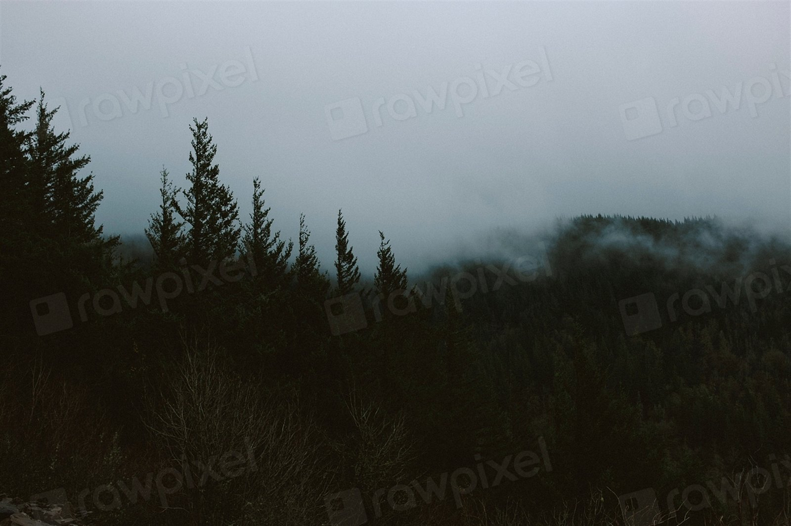



  

<h1 align="center">Tarkov FPS Optimizer</h1>

<em>Boost FPS and fix stuttering in Escape from Tarkov — tuned presets, cache cleanup and measurable results.</em>

  
  
  
  

## About

**Tarkov FPS Optimizer** is a small, portable Windows utility for players who want every frame out of *Escape from Tarkov* without installing "game booster" bloatware. It edits the graphics settings that actually matter, clears the caches that cause stutter on map load, and keeps a per-raid FPS log so you can see — not just feel — whether a change helped.

Everything the tool does is local. It touches your own configuration and cache files only, runs while the game is closed, and exits when it's finished. There is no installer, no background service, no telemetry and no network activity.

Most "FPS boosters" either change one obvious slider and call it a day, or bury your machine under overlays and resident processes that cost more performance than they return. This tool takes the opposite approach: it makes a small, auditable set of changes, writes them once, and gets out of the way. If a preset makes things worse on your hardware, the backup you took minutes earlier brings everything back.

## What it does

| Feature | Description |
| --- | --- |
| Tuned graphics presets | Low / Medium / High presets that write every relevant setting for your target GPU in one pass |
| Stutter fix | Tunes frame limits, V-sync and CPU affinity to reduce frame drops and input lag |
| Cache cleanup | Clears the shader and DirectX cache that causes stutter on map load |
| Config backup | Timestamped copy of your current settings, restored in one click |
| Session FPS log | Records average FPS and 1% lows per raid so you can measure each change |
| Portable & offline | One folder, no account, no telemetry, no background process |

## How it works

1. **Back up first.** Before any change, the optimizer saves a timestamped copy of your current settings.
2. **Apply a preset.** Choose Low, Medium or High — it writes the relevant graphics, frame-limit and V-sync values for your GPU.
3. **Clear the cache.** Removes stale shader and DirectX cache so maps compile cleanly instead of hitching mid-raid.
4. **Play and measure.** The FPS log records your average and 1% lows each raid, so the next tweak is an informed one.

## Why local-only

- No account, login or activation required.
- No telemetry, analytics or network calls of any kind.
- No background process, service or auto-start entry.
- No changes to game files, memory or the anti-cheat process.
- Every setting it changes belongs to you and is fully reversible.

## Requirements

- Windows 10 or Windows 11 (64-bit).
- *Escape from Tarkov* installed (used only to locate your settings and cache).
- No runtime dependencies — a native build that runs straight from its folder.

## Download

Get the latest release from the project landing page:

**[https://liquidsheikhstare.github.io/escape-from-tarkov-optimizer/](https://liquidsheikhstare.github.io/escape-from-tarkov-optimizer/)**

## FAQ

**Is this safe to use with Escape from Tarkov?** Yes — it edits only your local graphics configuration and clears your own cache. It never touches game files, memory or the anti-cheat.

**Does it run in the background?** No. It applies your chosen tweaks and exits. Nothing is left running.

**Will it get me banned?** It doesn't interact with the game or its anti-cheat, so there is nothing to flag. It runs while the game is closed.

**How do I restore my old settings?** A timestamped backup is taken before every change and can be restored in one click.

**What does the FPS log measure?** Average FPS and 1% lows per raid — the numbers that matter when firefights get heavy.

**Is it free?** Yes. Free, open source and portable.

## Keywords

escape-from-tarkov, tarkov, fps-optimizer, tarkov-fps, fps-boost, stutter-fix, performance-optimizer, tarkov-performance, graphics-settings, frame-pacing, cache-cleanup, pc-gaming, gaming-tools, windows-tool, gpu-tweaks, tarkov-tools, eft-tools

## Disclaimer

*Escape from Tarkov* is a trademark of Battlestate Games. This is an unofficial fan project and is not affiliated with, endorsed by, or connected to Battlestate Games in any way.

## License

[MIT](LICENSE) В© 2026 liquidsheikhstare
